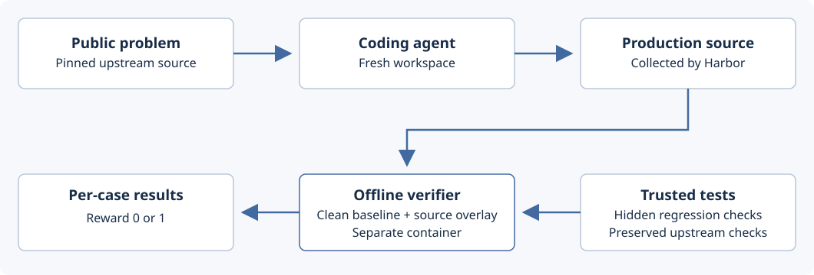

# Agent Reliability Task Pack

[](https://github.com/GautamBytes/agent-reliability-taskpack/actions/workflows/evidence-audit.yml)

Three real OSS bug-fix tasks for coding agents, packaged in **Harbor format**. An agent gets a problem and a broken codebase. A separate verifier checks whether its repair works and whether existing behaviour still works.

This is my personal task-authoring project. It adds task statements, extra regression checks, incomplete-fix controls and a reproducible evaluation setup around attributed upstream source and fixes.

**Start here:** [Follow one task below](#walk-through-one-task) · [Browse screenshots and logs](REVIEW.md) · [Run a task](docs/RUNNING.md) · [Compare with established benchmarks](docs/BENCHMARK_CONTEXT.md)

## What happens in a run



Problem and source → agent edits → submitted source → fresh verifier with trusted tests → named results and reward.

The agent's workspace contains public instructions, the starting repository and installed dependencies. The hidden tests and reference patch are absent during solving. They are public in this repository so reviewers can inspect them now.

## Walk through one task

The [AnyIO task](tasks/anyio-cancel-scope/instruction.md) shows the full process. It comes from [AnyIO issue #642](https://github.com/agronholm/anyio/issues/642).

### 1. Start with a real failure

A task-group host enters a cancellation shield while a sibling task waits for cancellation. Cancelling the parent can leave the sibling waiting forever on the asyncio backend. The same program completes on Trio.

The agent must make cancellation reach the unshielded sibling while keeping each task's own shield effective. Fixing the hang must also preserve nested cancellation, task-group startup, exceptions and timeouts.

Read [the exact problem and reproducer given to the agent](tasks/anyio-cancel-scope/instruction.md). The task starts at pinned upstream commit `3ea17f9f43a7b7078fcb597246dfbc1889a530cc`.

### 2. Let the agent make a repair

Harbor starts a fresh container from [the agent environment](tasks/anyio-cancel-scope/environment/Dockerfile). The agent can explore the full repository and run its public tests. Its submitted production source comes from `src/anyio/`.

For a real example, open [the 300-second agent's submitted patch](evidence/trials/anyio-cancel-scope-standard/submitted.patch) and [its tool calls and results](evidence/trials/anyio-cancel-scope-standard/trajectory.json). The patch changes the asyncio backend.

### 3. Grade the submitted source in a clean environment

The [task configuration](tasks/anyio-cancel-scope/task.toml) enables a separate verifier. [The verifier](tasks/anyio-cancel-scope/tests/verify.py) restores trusted baseline files and overlays only the permitted production source. Candidate changes to tests, dependencies or package configuration do not replace trusted files.

It runs 145 required upstream preservation cases and 20 additional private cases. The private cases cover ten cancellation journeys on both asyncio and Trio. Events establish execution order; bounded subprocesses turn hangs into failures.

The verifier writes named case results and `/logs/verifier/reward.txt`. Reward `1` requires every required check to pass. Missing cases, incomplete reports and unexpected skips fail the gate. Four known upstream skips or xfails are separately allowlisted.

### 4. Check that the new tests catch incomplete repairs

The selected upstream tests already pass on the broken starting version. The added tests must distinguish a full repair from a plausible partial one.

| Submitted source | Required upstream cases | Added private cases | Reward |
| --- | ---: | ---: | ---: |
| Original upstream version | 145/145 | 15/20 | 0 |
| Actual rejected upstream simplification | 145/145 | 17/20 | 0 |
| Attributed reference repair | 145/145 | 20/20 | 1 |

These are [recorded control results](evidence/final-anyio-controls/summary.json). The middle row is the [`immediate-parent` control](tasks/anyio-cancel-scope/controls/README.md). It preserves the original tests but misses cancellation through more distant ancestors. The private journeys expose the missing behaviour.

### 5. Replay the saved agent patch

The [replay tool](tools/replay.py) reconstructs the candidate from its exact patch, checks its submitted source hashes and runs the verifier again in a fresh offline container.

The [saved replay](evidence/replays/anyio-cancel-scope-standard/replay.json) matches every expected case status. Reviewers can inspect the patch, original results and replay without running a model.

## The three tasks

| Task | Repair required | Required checks | Starting problem and credits |
| --- | --- | ---: | --- |
| [AnyIO cancellation scopes](tasks/anyio-cancel-scope/instruction.md) | Propagate cancellation correctly through shielded hosts and nested scopes. | 145 upstream + 20 added | [Issue #642](https://github.com/agronholm/anyio/issues/642) · [Provenance](tasks/anyio-cancel-scope/provenance.json) |
| [Better Auth portable indexes](tasks/better-auth-indexes/instruction.md) | Keep device-code indexes, migrations, schema generators and validation consistent. | 50 upstream + 32 added + 1 compile | [Issue #10025](https://github.com/better-auth/better-auth/issues/10025) · [Collective authorship](tasks/better-auth-indexes/provenance.json) |
| [Werkzeug multipart parsing](tasks/werkzeug-multipart/instruction.md) | Preserve uploaded bytes when multipart boundaries split across reads. | 31 upstream + 34 added | [Regression family and local extension](tasks/werkzeug-multipart/provenance.json) |

The full repositories are vendored to preserve the exact starting source and make builds reproducible. The original source and fixes retain their authorship and licenses. The Better Auth reference includes my contribution to a collective merged fix. The Werkzeug reference includes a separately documented local correction.

## Recorded results

All **313 required reference checks pass**. All three original buggy versions fail. The verifiers reject ten incomplete fixes and accept three valid alternatives.

There are 317 reported entries because AnyIO retains two Python-version skips and two upstream xfails. Check counts describe parameterized cases, not 317 independent bugs.


This screenshot renders [saved JSON results](evidence/release-audit.json). It is not a new live test run. [The review guide](REVIEW.md) includes the other screenshots, every fix control, all six submitted patches and direct links to logs.

### Six native coding-agent attempts

Each task ran in a fresh container with Codex 0.166.0 and `gpt-6.1-sol`. The standard profile used medium reasoning and 300 seconds. The extended profile used high reasoning and 600 seconds.

| Task | Profile | Original report | Final report | Solve outcome |
| --- | --- | ---: | ---: | --- |
| AnyIO | Standard | 165/169 | 165/169 | Finished |
| AnyIO | Extended | 165/169 | 165/169 | Finished |
| Better Auth | Standard | 80/83 | 83/83 | Timed out; saved patch passes |
| Better Auth | Extended | 82/83 | 83/83 | Finished |
| Werkzeug | Standard | 65/65 | 65/65 | Finished |
| Werkzeug | Extended | 65/65 | 65/65 | Finished |

Five attempts finished normally. One hit its solve deadline. All six saved patches pass the final checks and were replayed from their exact source changes. AnyIO's four known nonpasses are included in its report denominator.

Better Auth's original failures rejected valid schema syntax. The verifier was corrected after all attempts finished, then the unchanged patches were rescored. The original results, correction history and timeout remain available in [TRIALS.md](TRIALS.md) and [FAIRNESS_REVISION.json](FAIRNESS_REVISION.json).

### Follow-up study with two frozen difficulty versions

The [multipart hardening study](experiments/multipart-hardening/README.md) adds ten fresh attempts, separate from the six above. Five attempts used a narrow upload-byte repair task with 36 required checks. Five used an expanded streaming-parser contract with 100 required checks. Both versions used the same starting source, model, reasoning setting, solve budget and container limits.

**The observed pass rate stayed at 5/5 to 5/5, or 100% to 100%.** Every run finished normally. The harder verifier rejects the previous full repair at 79/100, but the added cases did not reduce this model's solve rate in this small pilot.

The study preserves its [frozen protocol](experiments/multipart-hardening/protocol.json), all ten patches and per-test results, clean offline replays, and a [review screenshot](experiments/multipart-hardening/proof/results.jpg). It makes no claim of broad model difficulty or external benchmark acceptance.

## How this relates to established benchmarks

This is a **Harbor-format task pack**. It uses the same problem, environment, reference-solution and verifier structure described in [Harbor's task guide](https://docs.harborframework.com/tutorials/create-a-task), including [separate verification](https://docs.harborframework.com/tasks/separate-verifier).

Its real-issue repair and preservation checks follow the general pattern used by SWE-bench. It is not a SWE-bench dataset export or an accepted contribution to SWE-bench or Terminal-Bench.

The comparison is about task-authoring structure. This pack has three historical public tasks and one model family at two budgets. It does not establish the difficulty, breadth or external review of a major benchmark. Current Terminal-Bench guidance also calls for open-internet evaluation; these recorded runs restrict network access. [Read the source-backed comparison](docs/BENCHMARK_CONTEXT.md).

## Find the implementation

```text
tasks/<task>/
  instruction.md       What the agent must fix
  task.toml            Deadlines, resources and verifier settings
  environment/         Agent image and pinned upstream repository
  solution/            Attributed reference patch
  tests/               Separate verifier and behavioural checks
evidence/trials/        Submitted patches, source hashes and run records
evidence/replays/       Exact-source replay results
tools/                 Audit, replay and experiment tools
```

To check the saved evidence locally, use Python 3.11 or newer:

```sh
git clone https://github.com/GautamBytes/agent-reliability-taskpack.git
cd agent-reliability-taskpack
python3 tools/report.py
```

Expected output includes `"all_gates_passed": true`. This audits saved evidence and source hashes; it does not launch agents or containers. The [GitHub audit](https://github.com/GautamBytes/agent-reliability-taskpack/actions/workflows/evidence-audit.yml) performs that check and verifies the published file manifest.

For an actual baseline/reference run, an exact-source replay or a fresh coding-agent attempt, follow [the running guide](docs/RUNNING.md). It keeps new output separate from the historical records.

## Scope and ownership

Live database checks use SQLite. Generated Drizzle schemas execute against builder metadata. Other engines and Prisma receive representation checks. Historical fixes may be present in model training. The isolation controls are not a proof against every malicious candidate program.

This is my own project, without employer commissioning or external benchmark acceptance. See [verification limits](VERIFICATION.md), [ownership](OWNERSHIP.md), [source credits](SOURCES.md) and [license notices](NOTICE.md).
