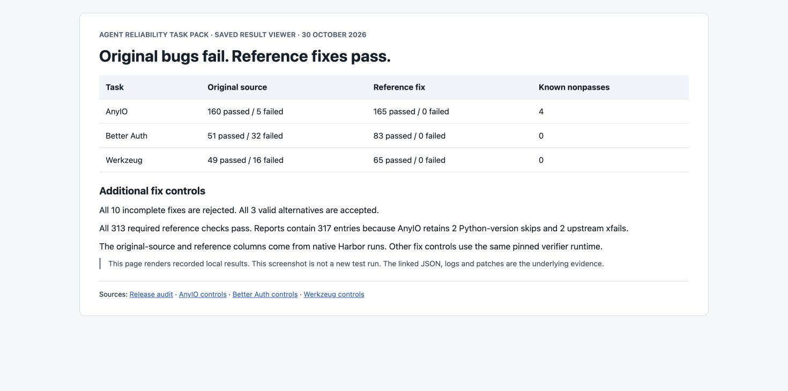
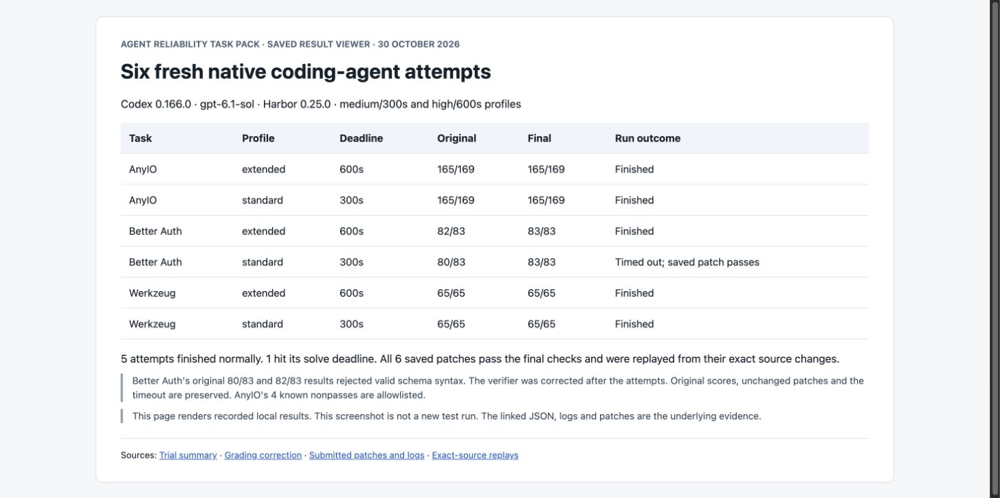
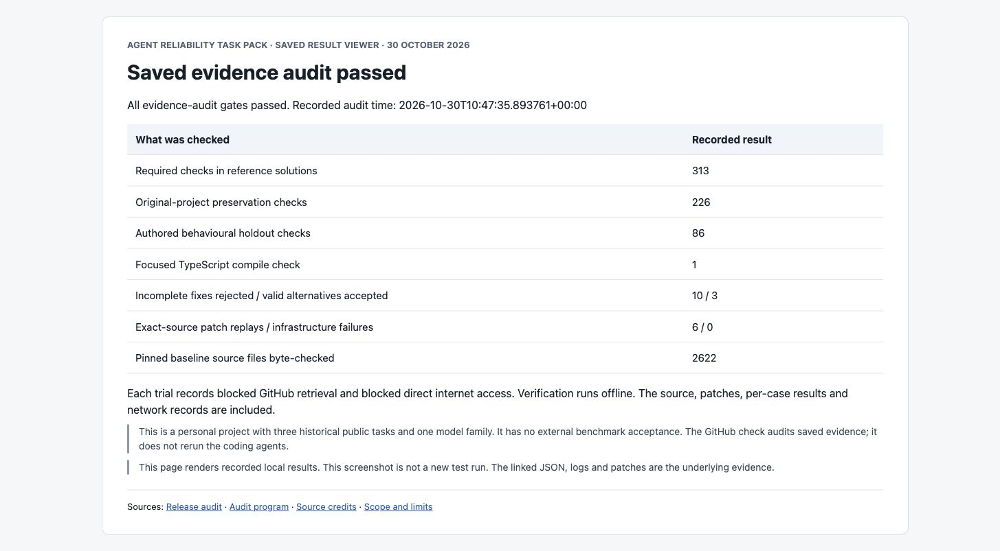

# Review without running

This is a personal task-pack project built. The recorded tests were hidden from the coding agents. Their source is public now for review.

## Start with these records

1. [Reference and original-source results](evidence/release-audit.json) show all 313 required reference checks passing, while all three original versions fail.
2. [Six agent attempts](TRIALS.md) show original scores, final scores and the one solve timeout.
3. [Grading corrections](FAIRNESS_REVISION.json) explain why valid schema syntax originally failed. The saved patches stayed unchanged.
4. [Source credits](SOURCES.md) link each task to real issues and upstream fixes.

## Screenshots of the saved results

These are actual browser captures of the [generated result viewer](tools/build_review.py). They render the linked saved JSON. They do not depict new live agent runs.

## Every incomplete and alternative fix

| Task | Variant | Passed / reported | Expected reward | Actual reward |
| --- | --- | ---: | ---: | ---: |
| AnyIO | [baseline](evidence/final-anyio-controls/summary.json) | 160/169 | 0 | 0 |
| AnyIO | [reference](evidence/final-anyio-controls/summary.json) | 165/169 | 1 | 1 |
| AnyIO | [ignore-child-shields](evidence/final-anyio-controls/summary.json) | 159/169 | 0 | 0 |
| AnyIO | [immediate-parent](evidence/final-anyio-controls/summary.json) | 162/169 | 0 | 0 |
| AnyIO | [omit-shield-toggle-restart](evidence/final-anyio-controls/summary.json) | 163/169 | 0 | 0 |
| Better Auth | [baseline](tasks/better-auth-indexes/evidence/release-semantic-matrix/summary.json) | 51/83 | 0 | 0 |
| Better Auth | [reference](tasks/better-auth-indexes/evidence/release-semantic-matrix/summary.json) | 83/83 | 1 | 1 |
| Better Auth | [mysql_without_existence_guard](tasks/better-auth-indexes/evidence/release-semantic-matrix/summary.json) | 82/83 | 0 | 0 |
| Better Auth | [schema_only](tasks/better-auth-indexes/evidence/release-semantic-matrix/summary.json) | 53/83 | 0 | 0 |
| Better Auth | [unchecked_custom_codes](tasks/better-auth-indexes/evidence/release-semantic-matrix/summary.json) | 79/83 | 0 | 0 |
| Better Auth | [utf16_index_names](tasks/better-auth-indexes/evidence/release-semantic-matrix/summary.json) | 81/83 | 0 | 0 |
| Better Auth | [equivalent-mssql-bound](tasks/better-auth-indexes/evidence/release-semantic-matrix/summary.json) | 83/83 | 1 | 1 |
| Better Auth | [equivalent-mysql-variable](tasks/better-auth-indexes/evidence/release-semantic-matrix/summary.json) | 83/83 | 1 | 1 |
| Better Auth | [equivalent-prisma-format](tasks/better-auth-indexes/evidence/release-semantic-matrix/summary.json) | 83/83 | 1 | 1 |
| Werkzeug | [baseline](tasks/werkzeug-multipart/evidence/docker-adversarial-controls/summary.json) | 49/65 | 0 | 0 |
| Werkzeug | [reference](tasks/werkzeug-multipart/evidence/docker-adversarial-controls/summary.json) | 65/65 | 1 | 1 |
| Werkzeug | [strip-payload-newlines](tasks/werkzeug-multipart/evidence/docker-adversarial-controls/summary.json) | 39/65 | 0 | 0 |
| Werkzeug | [upstream-3081-only](tasks/werkzeug-multipart/evidence/docker-adversarial-controls/summary.json) | 44/65 | 0 | 0 |
| Werkzeug | [upstream-3089-only](tasks/werkzeug-multipart/evidence/docker-adversarial-controls/summary.json) | 48/65 | 0 | 0 |
| Werkzeug | [forged-public-junit](tasks/werkzeug-multipart/evidence/docker-adversarial-controls/summary.json) | 49/65 | 0 | 0 |

AnyIO has four known upstream nonpasses. Werkzeug's forged-public-report control manufactures public records and still fails private assertions. It is a tampering probe, not an additional set of executed public tests.

## Inspect an agent's actual work

| Attempt | Source patch | Original per-case results | Final replay | Tool calls and results |
| --- | --- | --- | --- | --- |
| anyio-cancel-scope-extended | [Patch](evidence/trials/anyio-cancel-scope-extended/submitted.patch) | [Results](evidence/trials/anyio-cancel-scope-extended/results.json) | [Replay](evidence/replays/anyio-cancel-scope-extended/replay.json) | [Trace](evidence/trials/anyio-cancel-scope-extended/trajectory.json) |
| anyio-cancel-scope-standard | [Patch](evidence/trials/anyio-cancel-scope-standard/submitted.patch) | [Results](evidence/trials/anyio-cancel-scope-standard/results.json) | [Replay](evidence/replays/anyio-cancel-scope-standard/replay.json) | [Trace](evidence/trials/anyio-cancel-scope-standard/trajectory.json) |
| better-auth-indexes-extended | [Patch](evidence/trials/better-auth-indexes-extended/submitted.patch) | [Results](evidence/trials/better-auth-indexes-extended/results.json) | [Replay](evidence/replays/better-auth-indexes-extended/replay.json) | [Trace](evidence/trials/better-auth-indexes-extended/trajectory.json) |
| better-auth-indexes-standard | [Patch](evidence/trials/better-auth-indexes-standard/submitted.patch) | [Results](evidence/trials/better-auth-indexes-standard/results.json) | [Replay](evidence/replays/better-auth-indexes-standard/replay.json) | [Trace](evidence/trials/better-auth-indexes-standard/trajectory.json) |
| werkzeug-multipart-extended | [Patch](evidence/trials/werkzeug-multipart-extended/submitted.patch) | [Results](evidence/trials/werkzeug-multipart-extended/results.json) | [Replay](evidence/replays/werkzeug-multipart-extended/replay.json) | [Trace](evidence/trials/werkzeug-multipart-extended/trajectory.json) |
| werkzeug-multipart-standard | [Patch](evidence/trials/werkzeug-multipart-standard/submitted.patch) | [Results](evidence/trials/werkzeug-multipart-standard/results.json) | [Replay](evidence/replays/werkzeug-multipart-standard/replay.json) | [Trace](evidence/trials/werkzeug-multipart-standard/trajectory.json) |

The two Better Auth attempts also have `corrected-results.json` beside their original results. The 300-second timeout is retained in the Harbor result. Tool trajectories omit raw reasoning text.

## Scope

Live database checks use SQLite. Drizzle output executes against builder metadata. Other database engines and Prisma receive schema/SQL representation checks. This uses one model family at two budgets and three historical public tasks. It does not establish broad model difficulty or absence of training-data overlap. See [VERIFICATION.md](VERIFICATION.md) for the full limits.
