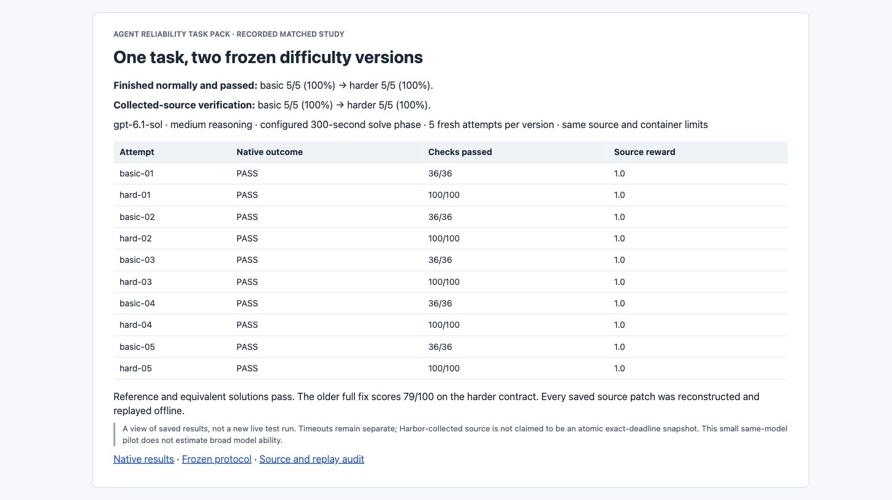

# Multipart task-hardening study

A matched pilot on two versions of one real Werkzeug repair task. Both versions start from the same pinned source. The harder version expands the explicit contract before any counted model attempt.



The screenshot shows saved records. The tables below link to the underlying patches, named test results and offline replays.

## Observed results

| Measure | Basic version | Harder version |
| --- | ---: | ---: |
| Fresh native coding-agent attempts | 5 | 5 |
| Finished normally and passed every check | 5/5 (100%) | 5/5 (100%) |
| Harbor-collected source passed every check | 5/5 (100%) | 5/5 (100%) |
| Solve-timeout outcomes | 0 | 0 |
| Required verifier cases | 36 | 100 |

The measured pass rate did not fall. The added requirements reject incomplete fixes, but this pilot does not show that they make this model less likely to solve the task.

Normal completion plus passing verification is the primary measure specified in the protocol before the runs. Collected-source verification is shown separately. Harbor collects artifacts after an attempt, so these are not claimed to be atomic filesystem snapshots taken exactly at the 300-second deadline.

The model is gpt-6.1-sol through Codex 0.166.0 and native Harbor 0.25.0. Every attempt has medium reasoning, a configured 300-second solve phase, two CPUs and 1 GiB of agent memory. Each round runs one basic and one hard attempt in fresh containers, with no private feedback or candidate reuse. All ten planned attempts are retained.

## What changed

The basic task repairs the real 64 KiB upload bug where a trailing CR is lost. Its verifier combines 31 selected upstream preservation cases and five direct Request regression cases.

The harder task adds byte-exact fragmented parsing through MultipartDecoder, FormDataParser and Request. It covers one-byte reads, padded delimiter lines, real EOF closure, false closing markers that must remain payload, repeated fields, empty binary parts, strict rejection and streaming progress. It has 31 upstream cases and 69 private parameter cases. Split positions and seeded partitions inside one case are subcases, not extra independent bugs.

Both public contracts and private verifiers were frozen before the counted runs. The hard reference is a local extension of the attributed upstream work. It is not claimed to be an accepted upstream fix or complete RFC conformance.

## Individual attempts

| Attempt | Native outcome | Passing checks | Collected source reward | Patch | Replay |
| --- | --- | ---: | ---: | --- | --- |
| [basic-01](runs/curated/basic-01/summary.json) | PASS | 36/36 | 1.0 | [Source changes](runs/curated/basic-01/submitted.patch) | [Proof](runs/replays/basic-01/replay.json) |
| [hard-01](runs/curated/hard-01/summary.json) | PASS | 100/100 | 1.0 | [Source changes](runs/curated/hard-01/submitted.patch) | [Proof](runs/replays/hard-01/replay.json) |
| [basic-02](runs/curated/basic-02/summary.json) | PASS | 36/36 | 1.0 | [Source changes](runs/curated/basic-02/submitted.patch) | [Proof](runs/replays/basic-02/replay.json) |
| [hard-02](runs/curated/hard-02/summary.json) | PASS | 100/100 | 1.0 | [Source changes](runs/curated/hard-02/submitted.patch) | [Proof](runs/replays/hard-02/replay.json) |
| [basic-03](runs/curated/basic-03/summary.json) | PASS | 36/36 | 1.0 | [Source changes](runs/curated/basic-03/submitted.patch) | [Proof](runs/replays/basic-03/replay.json) |
| [hard-03](runs/curated/hard-03/summary.json) | PASS | 100/100 | 1.0 | [Source changes](runs/curated/hard-03/submitted.patch) | [Proof](runs/replays/hard-03/replay.json) |
| [basic-04](runs/curated/basic-04/summary.json) | PASS | 36/36 | 1.0 | [Source changes](runs/curated/basic-04/submitted.patch) | [Proof](runs/replays/basic-04/replay.json) |
| [hard-04](runs/curated/hard-04/summary.json) | PASS | 100/100 | 1.0 | [Source changes](runs/curated/hard-04/submitted.patch) | [Proof](runs/replays/hard-04/replay.json) |
| [basic-05](runs/curated/basic-05/summary.json) | PASS | 36/36 | 1.0 | [Source changes](runs/curated/basic-05/submitted.patch) | [Proof](runs/replays/basic-05/replay.json) |
| [hard-05](runs/curated/hard-05/summary.json) | PASS | 100/100 | 1.0 | [Source changes](runs/curated/hard-05/submitted.patch) | [Proof](runs/replays/hard-05/replay.json) |

Each attempt directory also includes original per-case results, the native Harbor result, permitted-source hashes, a tool-only trajectory and network-boundary evidence. Exact-source replays reconstruct each patch and match the native case statuses.

## Grader controls

| Fixed source | Basic | Harder |
| --- | ---: | ---: |
| Original baseline | 33/36, rejected | 56/100, rejected |
| Attributed basic reference | 36/36, accepted | 50/100, rejected |
| Previous complete task-pack reference | 36/36, accepted | 79/100, rejected |
| New hard reference | 36/36, accepted | 100/100, accepted |
| Equivalent reference emitting Data chunks up to 64 bytes | 36/36, accepted | 100/100, accepted |

The authoritative matrices are [basic-final](evidence/verifier-author/basic-final/summary.json), [basic old-reference confirmation](evidence/verifier-author/basic-old-complete-final/summary.json) and [hard-final](evidence/verifier-author/hard-final/summary.json). The alternate event strategy confirms the grader does not demand one internal chunking strategy for the added fragmented-input cases. All control runs have zero skips.

## Inspect the proof

- [Frozen protocol](protocol.json), including runner, replay-tool and task fingerprints.
- [Saved-evidence audit](AUDIT.json) and [machine-readable summary](runs/summary.json).
- [Basic instructions](versions/basic/instruction.md) and [harder instructions](versions/hard/instruction.md).
- [Grader coverage and pre-freeze fixes](evidence/verifier-author/README.md).
- [Reference provenance](reference-evidence/reference-author/summary.json) and [decision trail](decisions.tsv).

## Reproduce

```sh
python3 experiments/multipart-hardening/verify_study.py
```

This audits committed records and reconstructs source patches without Docker or a model call. Python 3.11 or newer and Git are required. To rerun the actual offline grading of a saved patch, choose a new output directory:

```sh
python3 experiments/multipart-hardening/replay_study.py hard-01 --output /tmp/new-hard-01-replay
```

The original ten-attempt protocol is preserved. study.py refuses to overwrite existing runs. New experiments should have a new protocol and output directory, rather than changing the frozen conditions or replacing a failure.

## Limits

This is a five-attempt-per-condition pilot using one model family on a historical public repository. It is not a statistical estimate of broad model ability or proof of training-data independence. Both conditions restrict solving-time network access in the same way. The parser has a bounded public contract, not a complete MIME implementation. The existing candidate-code grading limitations are documented in the original task pack.
