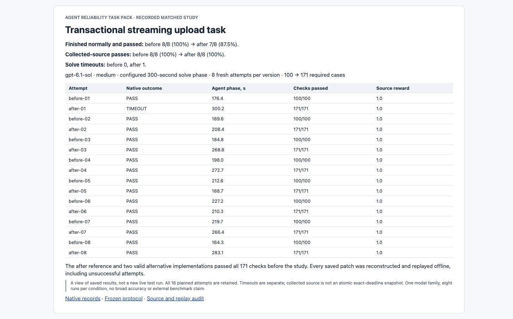
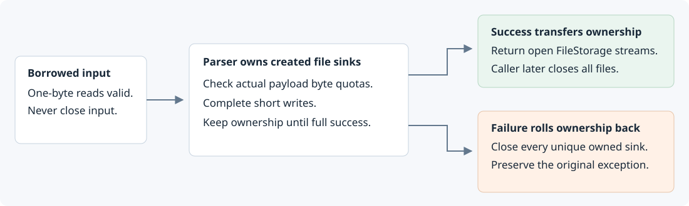

# Transactional multipart upload study

A new matched study of a cross-layer upload task. The earlier [100-check hardening study](../multipart-hardening/README.md) remains preserved with its original 5/5 to 5/5 result.



This screenshot renders saved records. Each row below links to native results, submitted source and an offline replay.

## Observed results

| Measure | Before | After |
| --- | ---: | ---: |
| Fresh native attempts | 8 | 8 |
| Finished normally and passed all checks | 8/8 (100%) | 7/8 (87.5%) |
| Harbor-collected source passes | 8/8 | 8/8 |
| Solve timeouts | 0 | 1 |
| Required cases | 100 | 171 |

The primary measure was specified before testing. A pass requires normal native completion and every required verifier case. Timeouts stay separate. Collected source is not claimed to be an atomic snapshot taken exactly at the solve deadline.

Both conditions use gpt-6.1-sol through Codex 0.166.0 and native Harbor 0.25.0, medium reasoning, the same pinned Werkzeug source, a configured 300-second solve phase, two CPUs and 1 GiB of agent memory. Eight paired rounds use fresh containers with no private feedback or candidate reuse. All sixteen planned runs are retained, without automatic Harbor episode retries.

## What makes the new task different



The before task repairs fragmented multipart parsing. The after task retains that entire contract and adds transactional ownership of temporary upload files across parser and Request APIs.

The new API enforces actual per-file and aggregate field-plus-file byte limits. It ignores misleading declared part lengths, handles short writes without losing data or counting retries twice, and resets budgets on parser reuse. Failures in reading, parsing, stream creation, writing, seeking or return construction must close all owned streams while preserving the original exception. Success transfers open streams to the caller. Request.close must handle repeated file names and shared stream identities without triggering lazy parsing.

Every policy is stated in the [public contract](CONTRACT.md) and [after instructions](versions/after/instruction.md), which were frozen before testing. This is a bounded repair and local feature task. It does not claim complete MIME conformance.

## Source and ownership

The source is the same pinned historical Werkzeug checkout used in the earlier task. The byte-preservation repair family retains its upstream credits. [Werkzeug PR #3101](https://github.com/pallets/werkzeug/pull/3101) supplies the real upstream resource-cleanup context. The two quota settings and stricter partial-write and ownership policies are local task extensions. They are not claimed to be accepted upstream features or newly discovered vulnerabilities.

## Every planned attempt

| Attempt | Native outcome | Agent phase, s | Checks passed | Collected source reward | Patch | Replay |
| --- | --- | ---: | ---: | ---: | --- | --- |
| [before-01](runs/curated/before-01/summary.json) | PASS | 176.4 | 100/100 | 1.0 | [Patch](runs/curated/before-01/submitted.patch) | [Replay](runs/replays/before-01/replay.json) |
| [after-01](runs/curated/after-01/summary.json) | TIMEOUT | 300.2 | 171/171 | 1.0 | [Patch](runs/curated/after-01/submitted.patch) | [Replay](runs/replays/after-01/replay.json) |
| [before-02](runs/curated/before-02/summary.json) | PASS | 189.6 | 100/100 | 1.0 | [Patch](runs/curated/before-02/submitted.patch) | [Replay](runs/replays/before-02/replay.json) |
| [after-02](runs/curated/after-02/summary.json) | PASS | 208.4 | 171/171 | 1.0 | [Patch](runs/curated/after-02/submitted.patch) | [Replay](runs/replays/after-02/replay.json) |
| [before-03](runs/curated/before-03/summary.json) | PASS | 184.8 | 100/100 | 1.0 | [Patch](runs/curated/before-03/submitted.patch) | [Replay](runs/replays/before-03/replay.json) |
| [after-03](runs/curated/after-03/summary.json) | PASS | 268.8 | 171/171 | 1.0 | [Patch](runs/curated/after-03/submitted.patch) | [Replay](runs/replays/after-03/replay.json) |
| [before-04](runs/curated/before-04/summary.json) | PASS | 198.0 | 100/100 | 1.0 | [Patch](runs/curated/before-04/submitted.patch) | [Replay](runs/replays/before-04/replay.json) |
| [after-04](runs/curated/after-04/summary.json) | PASS | 272.7 | 171/171 | 1.0 | [Patch](runs/curated/after-04/submitted.patch) | [Replay](runs/replays/after-04/replay.json) |
| [before-05](runs/curated/before-05/summary.json) | PASS | 212.6 | 100/100 | 1.0 | [Patch](runs/curated/before-05/submitted.patch) | [Replay](runs/replays/before-05/replay.json) |
| [after-05](runs/curated/after-05/summary.json) | PASS | 188.7 | 171/171 | 1.0 | [Patch](runs/curated/after-05/submitted.patch) | [Replay](runs/replays/after-05/replay.json) |
| [before-06](runs/curated/before-06/summary.json) | PASS | 227.2 | 100/100 | 1.0 | [Patch](runs/curated/before-06/submitted.patch) | [Replay](runs/replays/before-06/replay.json) |
| [after-06](runs/curated/after-06/summary.json) | PASS | 210.3 | 171/171 | 1.0 | [Patch](runs/curated/after-06/submitted.patch) | [Replay](runs/replays/after-06/replay.json) |
| [before-07](runs/curated/before-07/summary.json) | PASS | 219.7 | 100/100 | 1.0 | [Patch](runs/curated/before-07/submitted.patch) | [Replay](runs/replays/before-07/replay.json) |
| [after-07](runs/curated/after-07/summary.json) | PASS | 266.4 | 171/171 | 1.0 | [Patch](runs/curated/after-07/submitted.patch) | [Replay](runs/replays/after-07/replay.json) |
| [before-08](runs/curated/before-08/summary.json) | PASS | 164.3 | 100/100 | 1.0 | [Patch](runs/curated/before-08/submitted.patch) | [Replay](runs/replays/before-08/replay.json) |
| [after-08](runs/curated/after-08/summary.json) | PASS | 283.1 | 171/171 | 1.0 | [Patch](runs/curated/after-08/submitted.patch) | [Replay](runs/replays/after-08/replay.json) |

Each native directory also contains its original named case results, actual model metadata, tool-only trajectory, source hashes and network-boundary evidence. All exact-source replays must agree with the original reward and per-case outcomes, including failures.

## Failed checks in the after condition

These counts describe failed parameter cases across attempts. They are not counts of independent bugs or model trials.

No collected after-condition source failed a required case. Any timeout affects the normal-completion measure, while collected-source functional results remain separate.

## Review the verification

- [Frozen protocol](protocol.json), [public pre-evaluation commit](https://github.com/GautamBytes/agent-reliability-taskpack/commit/22de992c543029309fdd6e2e7df560dcf205a85f) and [saved-evidence audit](AUDIT.json).
- [Pre-freeze control and fairness gate](evidence/prefreeze-gate.json).
- [GitHub server-timestamp anchor](evidence/public-ci-anchor.json) and [fresh Docker verification workflow](https://github.com/GautamBytes/agent-reliability-taskpack/actions/workflows/evidence-audit.yml).
- [Private verifier coverage and control results](evidence/verifier-author/README.md).
- [Reference and alternative provenance](reference-evidence/reference-author/summary.json).
- [Failure review](FAILURE_REVIEW.md) and [decision trail](decisions.tsv).

## Audit or replay

```sh
python3 experiments/multipart-ownership/verify_study.py
```

Python 3.11 or newer and Git are required. This audits saved evidence and reconstructs every patch without a model call or Docker. GitHub Actions also checks the publication manifest and both historical studies, then executes all sixteen saved patches and twelve fixed-source controls in fresh offline Docker verifiers. It makes no model calls.

To execute one saved patch in a fresh offline Docker verifier, choose a new output directory:

```sh
python3 experiments/multipart-ownership/replay_study.py after-01 --output /tmp/new-ownership-replay
```

## Limits

Eight attempts per condition and one model family provide a descriptive pilot, not a broad accuracy estimate or statistical significance claim. Historical public source may have appeared in model training. Solving-time access is restricted to the model API, unlike open-internet evaluations. There is no external benchmark acceptance or commissioning. The task pack's documented candidate-code isolation limits still apply. All original studies and unsuccessful attempts remain available.
